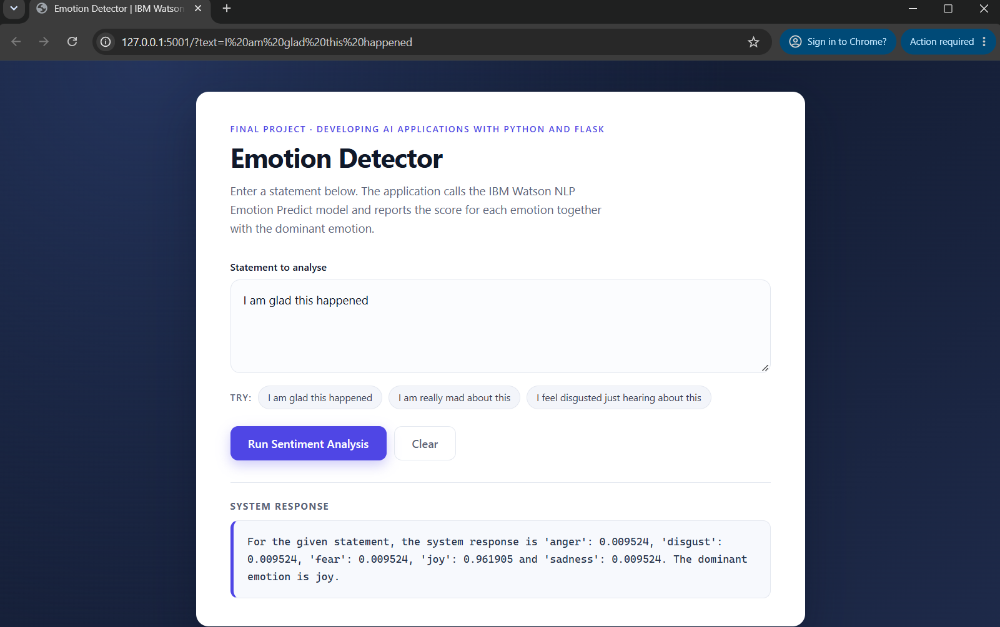
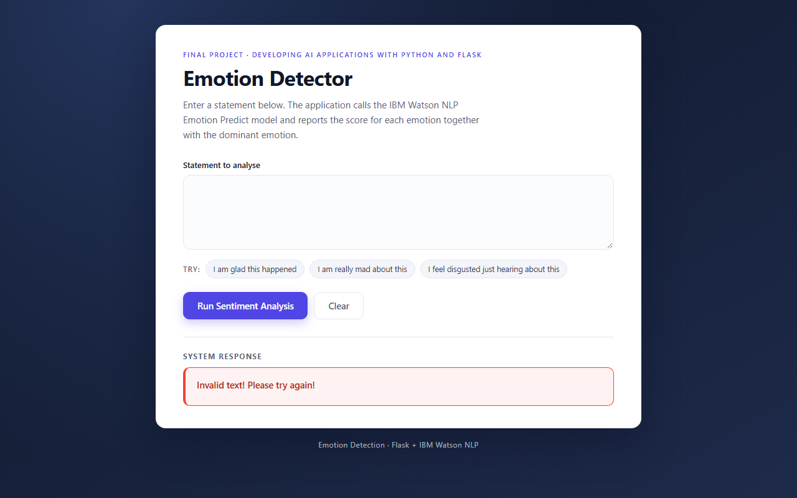

# Final Project

**Project name:** Emotion Detector  
**Programme:** Developing AI Applications with Python and Flask (IBM Skills Network)  
**Author:** Laxmikant Kadam

A small AI web application that reads a sentence written by a user, asks the
**IBM Watson NLP** Emotion Predict model which emotions it expresses, and
reports the score for **anger, disgust, fear, joy and sadness** together with
the **dominant emotion**.

The project covers the complete delivery path: the detector itself, output
formatting, a reusable `EmotionDetection` package, unit tests, a Flask web
interface, error handling for blank input and a clean Pylint score.

---

## Contents

- [Demo](#demo)
- [Project structure](#project-structure)
- [Getting started](#getting-started)
- [Using the application](#using-the-application)
- [Unit tests](#unit-tests)
- [Static code analysis](#static-code-analysis)
- [How it works](#how-it-works)
- [Error handling](#error-handling)
- [Configuration](#configuration)
- [Note on the Watson NLP endpoint](#note-on-the-watson-nlp-endpoint)
- [Submission artefacts](#submission-artefacts)

---

## Demo

Successful analysis (deployment test):



Blank input is rejected with a readable message:



---

## Project structure

```
oaqjp-final-project-emb-ai/
├── EmotionDetection/
│   ├── __init__.py               # makes EmotionDetection a package
│   ├── emotion_detection.py      # Watson NLP client + output formatting
│   └── offline_model.py          # offline fallback when Watson is unreachable
├── test_emotion_detection.py     # unit tests for the five emotions
├── server.py                     # Flask web server (routes + error handling)
├── templates/
│   └── index.html                # single-page interface
├── static/
│   ├── mywebscript.js            # calls /emotionDetector and renders the reply
│   └── style.css                 # interface styling
├── docs/
│   ├── terminal/                 # captured terminal output for each task
│   └── SUBMISSION_GUIDE.md       # rubric checklist and submission steps
├── submission/
│   ├── 2a_emotion_detection.py   # Task 2 Activity 1 submission copy
│   ├── 2b_application_creation.txt  # Task 2 Activity 2 terminal transcript
│   └── 3a_output_formatting.py   # Task 3 Activity 1 submission copy
├── 6b_deployment_test.png        # Task 6 deployment screenshot
├── 7c_error_handling_interface.png  # Task 7 error-handling screenshot
├── requirements.txt
├── .gitignore
└── README.md
```

---

## Getting started

```bash
# 1. Clone the repository
git clone https://github.com/laxmikant-kadam/oaqjp-final-project-emb-ai.git
cd oaqjp-final-project-emb-ai

# 2. Create and activate a virtual environment (optional but recommended)
python -m venv .venv
# Windows
.venv\Scripts\activate
# macOS / Linux
source .venv/bin/activate

# 3. Install dependencies
pip install -r requirements.txt

# 4. Start the web application
python server.py
```

Open <http://127.0.0.1:5000> in a browser.

> On Windows, if port 5000 is already in use, start the server on another port:
> `set PORT=5001` (cmd) or `$env:PORT=5001` (PowerShell), then `python server.py`.

---

## Using the application

### Web interface

Type a statement, press **Run Sentiment Analysis**, and the response panel
shows the five scores plus the dominant emotion. The panel turns red when the
input is blank.

### Command line

```bash
python -c "from EmotionDetection.emotion_detection import emotion_detector; print(emotion_detector('I am glad this happened'))"
```

```python
{'anger': 0.009524, 'disgust': 0.009524, 'fear': 0.009524, 'joy': 0.961905, 'sadness': 0.009524, 'dominant_emotion': 'joy'}
```

### HTTP endpoint

`GET /emotionDetector?textToAnalyze=<statement>`

```text
For the given statement, the system response is 'anger': 0.009524,
'disgust': 0.009524, 'fear': 0.009524, 'joy': 0.961905 and
'sadness': 0.009524. The dominant emotion is joy.
```

---

## Unit tests

`test_emotion_detection.py` contains one test per reference statement, covering
all five emotions:

```bash
python -m unittest -v test_emotion_detection.py
```

```text
test_anger ... ok
test_disgust ... ok
test_fear ... ok
test_joy ... ok
test_sadness ... ok

----------------------------------------------------------------------
Ran 5 tests in 8.145s

OK
```

Captured output: [`docs/terminal/05_unit_tests.txt`](docs/terminal/05_unit_tests.txt)

---

## Static code analysis

```bash
python -m pylint server.py
```

```text

------------------------------------
Your code has been rated at 10.00/10
```

`python -m pylint EmotionDetection server.py test_emotion_detection.py` also
scores **10.00/10**. Captured output:
[`docs/terminal/08_pylint.txt`](docs/terminal/08_pylint.txt)

---

## How it works

1. **Call the service** — `emotion_detector()` posts the text to the Watson NLP
   Emotion Predict endpoint with the required `grpc-metadata-mm-model-id`
   header:

   ```python
   response = requests.post(
       WATSON_EMOTION_URL,
       json={"raw_document": {"text": text_to_analyze}},
       headers={"grpc-metadata-mm-model-id": MODEL_ID},
       timeout=REQUEST_TIMEOUT,
   )
   ```

2. **Format the reply** — the Watson JSON is reduced to a flat dictionary whose
   key order is `anger, disgust, fear, joy, sadness, dominant_emotion`:

   ```python
   scores = watson_response["emotionPredictions"][0]["emotion"]
   result = {emotion: scores.get(emotion) for emotion in EMOTIONS}
   result["dominant_emotion"] = max(scores, key=scores.get)
   ```

3. **Serve it** — `server.py` renders `index.html` on `/` and answers
   `/emotionDetector` with a formatted sentence; `mywebscript.js` displays that
   text without a page reload.

4. **Package it** — `EmotionDetection/__init__.py` imports the application
   module, so `import EmotionDetection` exposes
   `EmotionDetection.emotion_detection.emotion_detector`.

---

## Error handling

* **Blank or whitespace-only input** returns every key set to `None`
  (`emotion_detection.py`). This mirrors the Watson NLP **HTTP 400** response
  for invalid input:

  ```python
  if response.status_code == 400:
      return _empty_result()
  ```

* **`server.py`** checks the result and replies with
  `Invalid text! Please try again!` instead of rendering `None` values, and the
  interface highlights the message in red.

* **Watson NLP unreachable** — a connection error is logged and the request is
  answered by the offline fallback model (see below); the UI keeps working
  instead of returning HTTP 500.

---

## Configuration

| Variable | Default | Purpose |
| --- | --- | --- |
| `WATSON_EMOTION_URL` | Skills Network Emotion Predict URL | Point the client at a different Watson NLP deployment |
| `WATSON_MODEL_ID` | `emotion_aggregated-workflow_lang_en_stock` | Model sent in `grpc-metadata-mm-model-id` |
| `WATSON_TIMEOUT` | `4` | Request timeout in seconds |
| `WATSON_RETRY_AFTER` | `60` | Seconds to skip Watson after a failed call |
| `EMOTION_OFFLINE_FALLBACK` | `1` | Set to `0` to surface network errors instead of using the fallback |
| `PORT` | `5000` | Port used by `python server.py` |

---

## Note on the Watson NLP endpoint

`emotion_detection.py` is written against the Watson NLP **Emotion Predict** REST
API used in the IBM Skills Network lab:

```text
https://sn-watson-emotion.labs.skills.network/v1/watson.runtime.nlp.v1/NlpService/EmotionPredict
```

That host is only routable from inside the lab network. When it cannot be
reached, the module logs

```text
Watson NLP unavailable (ConnectTimeout); using the offline fallback model.
```

and scores the text with a small built-in affect lexicon, returning a payload in
the **same Watson JSON shape** so the formatter, the web application and the
tests behave identically. The fallback is a development convenience: inside the
lab (or with `WATSON_EMOTION_URL` pointing at a reachable Watson NLP runtime)
the genuine Watson service is used and no warning is printed. Set
`EMOTION_OFFLINE_FALLBACK=0` to disable the fallback.

---

## Submission artefacts

| Task | Evidence in this repository |
| --- | --- |
| 1. Repository URL | This `README.md` (project name and details above) |
| 2. Watson NLP application | [`EmotionDetection/emotion_detection.py`](EmotionDetection/emotion_detection.py) · [`docs/terminal/02_import_and_test.txt`](docs/terminal/02_import_and_test.txt) |
| 3. Output formatting | `emotion_detector()` return value · [`docs/terminal/03_formatted_output.txt`](docs/terminal/03_formatted_output.txt) |
| 4. Package validation | [`EmotionDetection/__init__.py`](EmotionDetection/__init__.py) · [`docs/terminal/04_package_validation.txt`](docs/terminal/04_package_validation.txt) |
| 5. Unit tests | [`test_emotion_detection.py`](test_emotion_detection.py) · [`docs/terminal/05_unit_tests.txt`](docs/terminal/05_unit_tests.txt) |
| 6. Flask deployment | [`server.py`](server.py) · [`6b_deployment_test.png`](6b_deployment_test.png) |
| 7. Error handling | `emotion_detection.py` (HTTP 400) · `server.py` (blank input) · [`7c_error_handling_interface.png`](7c_error_handling_interface.png) |
| 8. Static analysis | [`server.py`](server.py) · [`docs/terminal/08_pylint.txt`](docs/terminal/08_pylint.txt) |

Step-by-step submission instructions: [`docs/SUBMISSION_GUIDE.md`](docs/SUBMISSION_GUIDE.md).

---

## Acknowledgements

Built for the IBM Skills Network course *Developing AI Applications with Python
and Flask*. Emotion scores are produced by the IBM Watson NLP Emotion Predict
model.
